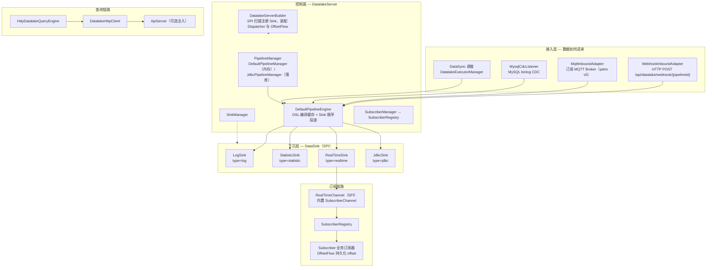
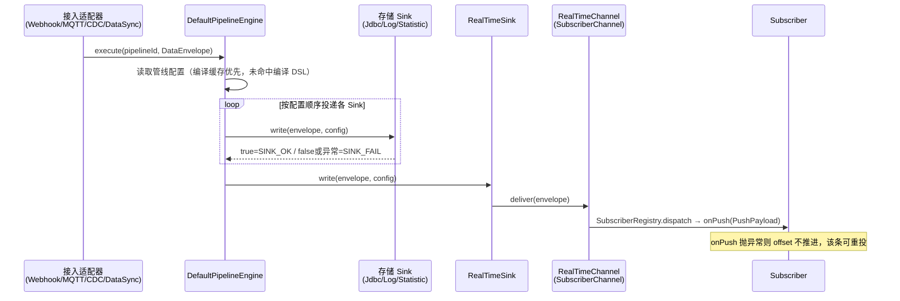

# Utils Support Datalake Parent

数据中台父模块：提供数据接入（Webhook / MQTT / MySQL CDC / DataSync 调度）、管线处理、数据下沉（Sink）、实时订阅与统一查询等数据湖/数据中台能力。

> 最后构建: 2026-07-17
> Java 25 + Maven 3.9

---

## 系统架构



扩展点（详见[扩展插件的实现和集成](#扩展插件的实现和集成)）：`DataSink`（数据下沉）、`RealTimeChannel`（实时投递通道）、`ActiveCollector` + `DataHandler`（自定义采集协议）、`Subscriber`（业务订阅器）。

> 口径说明：当前版本引擎执行「受理 → Sink 投递」主链路；管线 DSL 中的
> `filter` / `parser` / `cleaner` / `standardizer` 为预留扩展位，暂不参与执行。

## 数据接入方式

| 方式 | 入口类 | 方向 | 说明 |
|---|---|---|---|
| **Webhook 推送** | `WebhookInboundAdapter` | 外部 → 服务端 | `POST /api/datalake/webhook/{pipelineId}`（单条）与 `/batch`（批量）；应答状态码反映管线真实结果（`SINK_OK` 才是 200）。默认只绑 `127.0.0.1`，对外暴露必须配 `token` |
| **MQTT 订阅** | `MqttInboundAdapter` | 服务端 → Broker | MQTT 5.0（paho v5）；JSON 对象直接解析，数组/标量/非 JSON 文本包成 `{"payload": 原文}` |
| **MySQL CDC** | `MysqlCdcListener` | 服务端 → 数据库 | 监听 MySQL binlog 变更进入管线 |
| **DataSync 调度** | `DatalakeExecutorManager` | 服务端内部 | 注入 `DefaultDataSyncServer`，与数据湖共享 `DispatcherProvider` |
| **宿主直调** | `PipelineEngine.execute(pipelineId, envelope)` | 进程内 | 宿主业务代码直接构造 `DataEnvelope` 投递 |

## 模块结构

```
utils-support-datalake-parent
├── utils-support-datalake-sink-starter      ← SPI 契约 + 数据模型 + 管线引擎 + 4 个内置 Sink
├── utils-support-datalake-starter           ← 服务端装配（DatalakeServer/Builder、SinkManager、SubscriberManager、执行器）
├── utils-support-datalake-webhook-starter   ← Webhook HTTP 入站适配器
├── utils-support-datalake-mqtt-starter      ← MQTT 入站适配器
├── utils-support-datalake-cdc-starter       ← MySQL CDC 监听
├── utils-support-datalake-subscribe-starter ← 订阅端（Subscriber / Registry / Channel）
└── utils-support-datalake-query-starter     ← 查询客户端与 HTTP 查询引擎
```

编写扩展实现只需依赖 `utils-support-datalake-sink-starter` 中的 SPI 契约，无需依赖服务端装配模块。

## 数据流



- `DataEnvelope` 携带 `parsed`（业务数据）、`pipelineId`、`topics`（路由过滤，`log` 前缀视为日志型）、`timestamp`（受理时刻，即订阅 offset 取值）、`traceId` 与 `trace` 轨迹。
- 单个 Sink 失败不影响其余 Sink；`write` 返回 `false` 或抛异常记为 `SINK_FAIL`。
- 订阅器必须登记进 `SubscriberRegistry` 才会被投递链路命中。

## 模块说明

| 模块 | 说明 |
|---|---|
| **utils-support-datalake-sink-starter** | SPI 契约（`DataSink` / `AccessSink` / `RealTimeChannel` / `ActiveCollector` / `PipelineEngine` / `PipelineManager`）、数据模型（`DataEnvelope` / `PipelineState`）、`DefaultPipelineEngine` 与管线管理器、4 个内置 Sink |
| **utils-support-datalake-starter** | 服务端装配：`DatalakeServer` / `DatalakeServerBuilder`、`SinkManager` / `SubscriberManager`、`DatalakeExecutorManager`（对接 DataSync） |
| **utils-support-datalake-webhook-starter** | HTTP 入站适配器（单条/批量推送、健康检查、token 校验） |
| **utils-support-datalake-mqtt-starter** | MQTT 5.0 入站适配器（Broker 订阅 → 管线） |
| **utils-support-datalake-cdc-starter** | MySQL CDC 监听（binlog → 管线） |
| **utils-support-datalake-subscribe-starter** | 订阅端：`Subscriber` / `SubscriberRegistry` / `SubscriberChannel`（`RealTimeChannel` 默认实现）/ `RealTimeDatalakeSubscriber` |
| **utils-support-datalake-query-starter** | 查询：`DatalakeHttpClient` / `HttpDatalakeQueryEngine`（实现通用 `Engine` 接口，经 HTTP 调数据湖 API 服务端） |

## 关键 SPI 接口

### DataSink — 数据下沉

```
com.chua.datalake.support.spi.sink.DataSink
  ├── type()                     Sink 类型名，即 DSL sink[].type（如 "jdbc"）
  ├── start() / stop()           生命周期
  ├── write(envelope, config)    写入一条数据；false/异常 = SINK_FAIL
  └── getDataSource()            关联数据源；纯转发型返回 null
```

### AccessSink — 访问型 Sink 标记

```
com.chua.datalake.support.spi.sink.AccessSink（仅标记，继承 DataSink）
  实现它的 Sink 会被 DispatcherProvider 绑定到 topic "#"：
  每条数据即时感知、无落盘（LogSink / RealTimeSink / StatisticSink 均属此类）。
```

### RealTimeChannel — 实时投递通道

```
com.chua.datalake.support.spi.realtime.RealTimeChannel
  ├── name()                     通道名
  └── deliver(envelope)          投递一条数据；false = 通道拒收
```

### ActiveCollector — 主动采集器（协议扩展点）

```
com.chua.datalake.support.spi.collection.ActiveCollector
  ├── protocol() / defaultPort()          协议名 / 默认端口
  ├── start(port) / stop() / isRunning()  生命周期
  ├── registerMapping(topic, pipelineId)  topic → 管线映射
  ├── unregisterMapping(topic) / getMappings() / subscribedTopics()
  ├── setHandler(DataHandler)             注入数据处理器
  └── getStatus()                         状态键值对

com.chua.datalake.support.spi.collection.DataHandler
  └── handle(pipelineId, envelope)        采集数据进入管线
```

### PipelineEngine / PipelineManager / PipelineConfig — 管线

```
com.chua.datalake.support.spi.pipeline.PipelineEngine
  └── execute(pipelineId, envelope)       执行一条管线

com.chua.datalake.support.spi.pipeline.PipelineManager
  └── savePipeline / getPipeline / deletePipeline / pipelineIds

管线 DSL 结构（PipelineConfig）：
{
  "id": "pipeline-001",
  "stages": {
    "default": {
      "filter": [{"name": "null-filter"}],
      "parser": [{"name": "json"}],
      "sink": [{"type": "jdbc", "table": "t_event"}, {"type": "realtime"}]
    }
  }
}
```

### Subscriber — 订阅器（subscribe-starter）

```
com.chua.datalake.support.subscriber.Subscriber
  ├── subscriberId()             唯一标识
  ├── topics()                   订阅主题集合；空 = 接收全部
  └── onPush(PushPayload)        推送一条数据；抛异常则位点不推进、可重投
```

## 扩展插件的实现和集成

### 1. 扩展点总览

| 扩展点 | 接口（包 `com.chua.datalake.support.spi`） | 触发时机 | 内置实现 |
|---|---|---|---|
| 数据下沉 | `sink.DataSink`（或 `sink.AccessSink`） | 管线投递阶段，按 DSL `sink[].type` 匹配 | `log` / `statistic` / `realtime` / `jdbc` |
| 实时通道 | `realtime.RealTimeChannel` | `RealTimeSink` 收到数据后遍历所有通道 | `subscriber`（订阅端内置） |
| 采集协议 | `collection.ActiveCollector` + `collection.DataHandler` | 自定义协议接入（监听/轮询外部数据源） | —（内置接入走 InboundAdapter 形态） |
| 业务订阅 | `subscribe.Subscriber`（subscribe-starter） | 通道投递时按 topics 路由 | `AbstractDatalakeSubscriber` / `RealTimeDatalakeSubscriber` |

### 2. 注册机制

扩展实现通过 common-starter 的 `ServiceProvider`（SPI）发现，有两条路径：

**路径 A：`META-INF/extensions` 登记文件（推荐；Spring 自动装配宿主下请走此路径）**

1. 实现 SPI 接口并标注 `@Spi("名称")`（名称即 DSL 中的 `type`），类需提供无参构造；
2. 在自己模块的 `src/main/resources/META-INF/extensions/<SPI 接口全限定名>` 文件中追加实现类全限定名（每行一个，支持 `别名=全限定名`）；
3. `DatalakeServerBuilder.build()` 构建期执行 `ServiceProvider.of(DataSink.class)` 扫描，把全部实现注册进 Sink 注册表（`putIfAbsent`，手工注册优先）。

```
# 文件：src/main/resources/META-INF/extensions/com.chua.datalake.support.spi.sink.DataSink
com.chua.datalake.support.sink.LogSink
com.chua.datalake.support.sink.StatisticSink
com.chua.datalake.support.sink.RealTimeSink
com.chua.datalake.support.sink.JdbcSink
com.example.datalake.ElasticsearchSink      ← 新增一行
```

> ⚠️ 只加 `@Spi` 注解而不建登记文件：编译通过，但运行期静默不注册——管线按 type
> 找不到 Sink 时引擎不写编译缓存，该 Sink 永不生效。登记文件是 git 跟踪的源码资源，
> 编译期不会为纯 `@Spi` 类自动生成索引。

**路径 B：编程注册（自建服务端时）**

不经 Spring 自动装配、自行构建服务端时，可在 `build()` 之前注册：

```java
DatalakeServer server = DatalakeServerBuilder.builder()
        .registerSink(new ElasticsearchSink())   // 手工注册，优先于 SPI 扫描
        .build();
server.start();
```

### 3. 自定义 Sink（数据下沉）

```java
@Spi("es")
public class ElasticsearchSink implements DataSink {

    @Override
    public String type() {
        return "es";                       // DSL 中 sink[].type = "es"
    }

    @Override
    public void start() {
        // 服务端启动时回调：初始化客户端、连接池等
    }

    @Override
    public void stop() {
        // 服务端停止时回调：释放资源
    }

    @Override
    public boolean write(DataEnvelope envelope, Map<String, Object> config) {
        // envelope.getParsed() = 业务数据
        // config = DSL 中该 sink 节点除 type 外的键值，
        //          如 {"type":"es","index":"logs-2026"} → config = {"index":"logs-2026"}
        // 返回 false 或抛异常 = SINK_FAIL（记入统计与 trace，不影响其余 Sink）
        return true;
    }

    @Override
    public EngineDataSource<?> getDataSource() {
        return null;   // 纯转发型返回 null；需要被查询的落盘型 Sink 应返回有效数据源
    }
}
```

DSL 挂载示例（经 `POST /v2/datalake/pipelines` 保存，请求体 `{"id": "...", "dsl": "..."}`）：

```json
{
  "id": "pipeline-es-001",
  "stages": {
    "default": {
      "sink": [
        {"type": "es", "index": "logs-2026"},
        {"type": "realtime"}
      ]
    }
  }
}
```

选型口径：

- **落盘/可查**（要参与查询链路）→ 实现 `DataSink` 并返回有效 `getDataSource()`（参考 `JdbcSink`）；
- **即时转发**（日志审计、推送等，无落盘）→ 实现 `AccessSink`，自动绑定 topic `#` 感知全量数据（参考 `LogSink`）。

### 4. 自定义实时通道（RealTimeChannel）

`RealTimeSink` 本身不决定数据去向，只把数据交给所有已登记的 `RealTimeChannel`；内置的 `SubscriberChannel` 投递给订阅器，第三方可再加 WebSocket / SSE / HTTP 回调等通道：

```java
@Spi("ws-push")
public class WebSocketPushChannel implements RealTimeChannel {

    @Override
    public String name() {
        return "ws-push";
    }

    @Override
    public boolean deliver(DataEnvelope envelope) {
        // 推送给 WebSocket 在线会话；无人接收或发送失败返回 false
        return WebSocketHub.broadcast(envelope.getParsed());
    }
}
```

登记文件：`META-INF/extensions/com.chua.datalake.support.spi.realtime.RealTimeChannel` 追加一行。

注意：管线声明了 `"type": "realtime"` 且所有通道都拒收时，该条数据记 `SINK_FAIL`，不会静默丢弃。

### 5. 自定义采集协议（ActiveCollector + DataHandler)

需要接入新协议（自建 TCP 上报、第三方 API 轮询等）时实现 `ActiveCollector`：

```java
public class MyProtocolCollector implements ActiveCollector {

    private final Map<String, String> mappings = new ConcurrentHashMap<>();
    private volatile DataHandler handler;
    private volatile boolean running;

    @Override public String protocol() { return "MYPROTO"; }
    @Override public int defaultPort() { return 9100; }

    @Override
    public void start(int port) throws Exception {
        // 监听端口或启动轮询线程；每收到一条数据：
        String pipelineId = mappings.get(topic);
        DataEnvelope envelope = DataEnvelope.builder()
                .parsed(payload)                 // Map<String, Object> 业务数据
                .pipelineId(pipelineId)
                .timestamp(System.currentTimeMillis())
                .topics(Set.of(topic))           // 可选：用于订阅端路由
                .build();
        handler.handle(pipelineId, envelope);    // 交给管线执行
        running = true;
    }

    @Override public void stop() { running = false; /* 释放监听 */ }
    @Override public boolean isRunning() { return running; }

    @Override public void registerMapping(String topic, String pipelineId) { mappings.put(topic, pipelineId); }
    @Override public void unregisterMapping(String topic) { mappings.remove(topic); }
    @Override public Map<String, String> getMappings() { return Collections.unmodifiableMap(mappings); }
    @Override public Set<String> subscribedTopics() { return Collections.unmodifiableSet(mappings.keySet()); }
    @Override public void setHandler(DataHandler handler) { this.handler = handler; }
    @Override public Map<String, Object> getStatus() { return Map.of("running", running, "mappings", mappings.size()); }
}
```

`DataHandler` 由服务端注入（`setHandler`），实现方是管线管理器的适配层；采集器内部只负责「连接数据源 + 包装 `DataEnvelope` + 调 `handler.handle`」。仓库内的 `MqttInboundAdapter` / `WebhookInboundAdapter` 是「协议 → DataEnvelope → PipelineEngine」的现成参照。

### 6. 接入业务订阅器（Subscriber）

消费实时数据的业务方实现 `Subscriber`，并**登记**进 `SubscriberRegistry`（经 `SubscriberManager` 转发登记，或启动时显式注册）：

```java
@Component
public class AlarmSubscriber implements Subscriber {

    @Override
    public String subscriberId() {
        return "alarm-sub-001";
    }

    @Override
    public Set<String> topics() {
        return Set.of("alarm");          // 空集合 = 接收全部主题
    }

    @Override
    public void onPush(PushPayload payload) {
        // 处理失败请抛异常：位点不推进，该条数据可重投
    }
}
```

关键约束：只在本地 `new` 出来、未登记的订阅器收不到任何数据。`PushPayload` 的 offset 取自 `DataEnvelope.timestamp`，由 `OffsetFlow` 持久化。订阅端可参考 `AbstractDatalakeSubscriber` / `RealTimeDatalakeSubscriber`。

### 7. Spring 宿主集成

1. **引入依赖**：宿主按需依赖 `utils-support-datalake-starter`（服务端核心）与 `webhook` / `mqtt` / `cdc` / `subscribe` / `query` 子模块；
2. **开启开关**：宿主配置 `datalake.enabled=true`，api 仓 `DatalakeAutoConfiguration` 构建并同步启动 `DatalakeServer`（该装配不注入 API 服务端，不开设任何 HTTP 端口；需要查询面时经 `DatalakeServerBuilder.apiServer(Server)` 自行注入）；
3. **管线落库**：宿主存在 `DataSource` 且未自定义 `PipelineManager` 时，`DatalakeManageAutoConfiguration` 自动装配 `JdbcPipelineManager`，管线配置落库 `sys_datalake_pipeline`，重启不丢；
4. **管理端点**：`DatalakeManageController` 暴露 `/v2/datalake/**`（鉴权走宿主统一接口鉴权）：
   - `GET /v2/datalake/pipelines`、`GET /v2/datalake/pipelines/{id}` — 管线查询（含 DSL 原文与运行计数）
   - `POST /v2/datalake/pipelines`、`DELETE /v2/datalake/pipelines/{id}` — 管线保存/删除（保存前做 DSL 解析校验，删除同步清编译缓存）
   - `GET /v2/datalake/stats` — StatisticSink 累计吞吐、管线/订阅器/Sink 数量与单管线计数
   - `GET /v2/datalake/subscribers` — 已登记订阅器清单
   - `GET /v2/datalake/sinks` — 已注册 Sink 清单（类型 + 是否带数据源）
5. **自定义扩展**：Sink / RealTimeChannel 经 `META-INF/extensions` 登记后即被自动装配的服务端扫到；Spring 容器里的普通 Bean **不会**自动注册为 Sink——要么走 SPI 登记文件，要么自建 `DatalakeServer` Bean 时用 `DatalakeServerBuilder.registerSink()` 编程注册。

## 外部集成

| 中间件 | 集成点 | 说明 |
|---|---|---|
| Kafka | `KafkaDispatcherProvider`（`utils-support-kafka-starter`） | 作为 `DispatcherProvider` 注入 `DatalakeServerBuilder`，替代默认实现 |
| RabbitMQ | `RabbitmqDispatcherProvider`（`utils-support-rabbitmq-starter`） | 同上 |
| Chronicle | `ChronicleDispatcherProvider`（默认） | 基于共享目录的跨进程分发，`dataPath` 指定目录 |
| MQTT | `MqttInboundAdapter`（datalake-mqtt-starter） | 订阅 Broker → 管线 |
| MySQL | `MysqlCdcListener` / `JdbcSink` / `JdbcPipelineManager` | CDC 接入、数据落盘、管线配置持久化 |
| HTTP | `WebhookInboundAdapter`（datalake-webhook-starter） | 外部系统推送 |
| 数据同步 | `DataSyncServer` + `DatalakeExecutorManager` | 与 datasync 共享 DispatcherProvider 与执行器 |
| 查询 | `DatalakeHttpClient` / `HttpDatalakeQueryEngine`（datalake-query-starter） | 实现通用 `Engine` 接口，经 HTTP 走数据湖 API |

## 参考实现

| 想了解 | 看这个类 |
|---|---|
| 最简 Sink（AccessSink，纯转发） | `com.chua.datalake.support.sink.LogSink` |
| 存储型 Sink（表名/列名白名单 + 参数化写入） | `com.chua.datalake.support.sink.JdbcSink` |
| 实时投递链路 | `RealTimeSink` → `SubscriberChannel` → `SubscriberRegistry` |
| DSL 编译缓存与 Sink 投递语义 | `com.chua.datalake.support.engine.DefaultPipelineEngine` |
| HTTP 推送接入 | `com.chua.datalake.support.webhook.WebhookInboundAdapter` |
| MQTT 接入 | `com.chua.datalake.support.mqtt.MqttInboundAdapter` |
