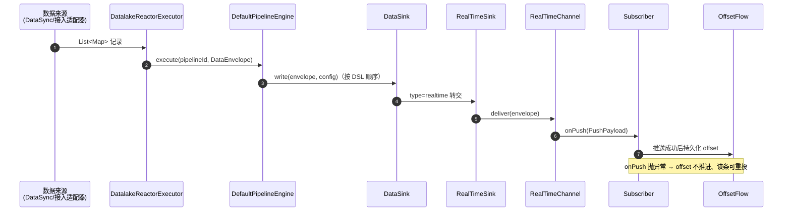

# Datalake 架构图

## 模块依赖关系

```
datalake-starter (聚合控制点)
  ├── common-starter
  ├── datalake-sink-starter          → common-starter
  ├── datalake-subscribe-starter     → common-starter
  ├── datalake-query-starter         → common-starter
  ├── datasync-starter               (optional)
  └── calcite-starter

datalake-sink-starter        → common-starter
datalake-subscribe-starter   → common-starter
datalake-query-starter       → common-starter  (通过 HttpClient 调用 datalake-starter ApiServer)
```

## 控制平面

### DatalakeServerBuilder

DatalakeServerBuilder 统一注入所有依赖，构建 DatalakeServer 实例。
构建成功后启动：
  - DatalakeReactorExecutor（注入 DataSyncServer 时）
  - PipelineEngineManager → DefaultPipelineEngine
  - SinkManager → 注册所有 Cache & AccessSink 实例
  - SubscriberManager → 订阅器登记与查询（进程级 SubscriberRegistry 的门面）
  - ApiServer → 拼 Sink.DataSource 进行查询

### DatalakeServer

层次结构：
1. 采集层 → DataSync Source（可独立运行或注入 DatalakeServerBuilder）
2. 执行层 → DatalakeReactorExecutor → PipelineEngine → DispatcherProvider
3. 告警层 → SinkManager 管理的 Sink 实例
4. 订阅管理层 → SubscriberManager 结合 OffsetFlow 管理 reposition
5. 查询暴露层 → ApiServer 利用 calcite 聚合 Sink.DataSource

## 数据流

DataSync Source 通过 DatalakeReactorExecutor 把 List<Map> → PipelineEngine.execute(pipelineId,envelope) → Filter/Parser/Cleaner/Standardizer → applySinks → DispatcherProvider.publish(sinkType, envelope)。

> 口径注：当前版本引擎直接按 DSL 顺序调用各 Sink（编译缓存优化）；
> Filter/Parser/Cleaner/Standardizer 中间阶段与经 Dispatcher 发布为规划中链路。

DispatcherProvider 底层是 Chronicle 持久化，Sink 监听自己的触发调径：
- AccessSink（trigger="#")→ RealTimeSink 实时推送/LogSink 审计/StatisticSink 统计
- 存储 Sink → JdbcSink 写中间库 → 管理 DataSource

## 排队与防重

DatalakeReactorExecutor 会为每个 `List<Map>` 中的每条记录构建 `DataEnvelope`，内部带上 `timestamp` 作为 offset 标记。

SubscriberManager 负责 offset 维护逻辑：
- 启动时从 OffsetFlow 中读取各 subscriber 最后的 offset
- 收到 RealTimeSink 推送的数据时，校验 offset 顺序
- 若顺序合法则推进 offset 并在推送成功落盘 OffsetFlow Δ +1

OffsetFlow 依赖 common-starter 的 offset 提供者，默认用文件持久化，可切换为 Redis 提供。

## 查询 (query)

query-starter 只依赖 common-starter。通过 HttpClient 请求 datalake-starter 的 ApiServer /query 路由。

ApiServer 内部使用 calcite-starter 聚合所有 DataSink 的 DataSource（sSimplex model 引擎执行 + MetaData）。

## 时序图



## 接口定义

### com.chua.datalake.support.spi.sink.DataSink

```java
public interface DataSink {
    String  type();          // 队列 topic（jdbc/log/statistic……）
    void    start();
    void    stop();
    boolean write(DataEnvelope envelope, Map<String, Object> config);
    EngineDataSource<?> getDataSource();   // 返回 被 DataSource 对象（存储类有，AccessSink 返回 null）
}
```

### com.chua.datalake.support.spi.sink.AccessSink

```java
public interface AccessSink extends DataSink {
    // 仅标记接口，不增加方法
}
```

### com.chua.datalake.support.spi.pipeline.PipelineEngine

```java
public interface PipelineEngine {
    void execute(String pipelineId, DataEnvelope envelope);
}
```
